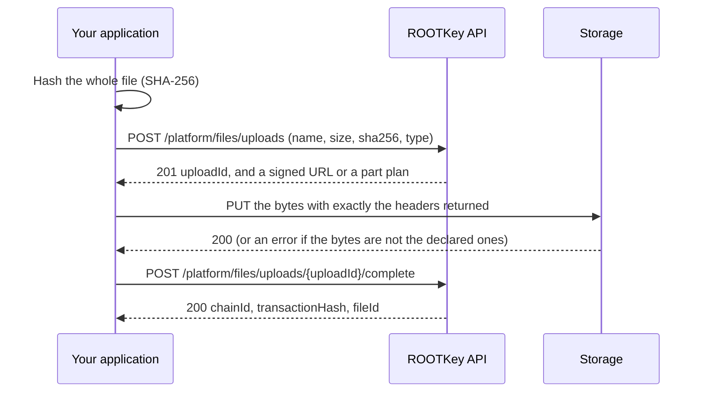

With a direct upload, the file's bytes never pass through the ROOTKey API. You declare the file and its SHA-256, ROOTKey answers with a signed URL, you send the bytes **straight to the storage**, and then you complete the upload so ROOTKey can anchor the hash and create the file. The API only handles small JSON requests, so uploads stay fast for large files and keep up when you send many files at once.

[Create file](/api-reference/platform/endpoint/files/create-file), which sends the file in the request itself, stays available. Use a direct upload when the file is large, or when you register many files, and keep Create file for the simple case.

<Note>
  Direct uploads are not enabled on every deployment. If [Start an upload](/api-reference/platform/endpoint/files/start-file-upload) answers `404` with the `errorCode` [`presigned_file_upload_disabled`](/api-reference/errors#presigned_file_upload_disabled), use [Create file](/api-reference/platform/endpoint/files/create-file) instead.
</Note>

---

## How it works



The storage itself checks the bytes against the SHA-256, the length and the media type you declared, so a file can only be stored if it is the file you said it is. Nothing is anchored until you complete the upload, and **a hash that was not verified is never anchored**.

ROOTKey picks the mode when you start the upload, and your client follows what the response says:

| `mode` | When | What you do |
| --- | --- | --- |
| `single` | Smaller files (up to 32 MiB at the time of writing) | One `PUT` to `upload.url`, then complete. |
| `multipart` | Larger files | Request URLs for the parts, `PUT` each part, then complete. |

---

## Upload a file

<Steps>
  <Step title="Hash the file">
    Compute the SHA-256 of the **whole** file, as 64 hexadecimal characters. This is the hash that gets anchored.
  </Step>
  <Step title="Start the upload">
    [Start an upload](/api-reference/platform/endpoint/files/start-file-upload) with the vault, the file name, its size in bytes, the hash and the media type.

    ```bash
    curl -X POST https://api.rootkey.ai/api-v1/platform/files/uploads \
      -H "x-api-key: YOUR_API_KEY" \
      -H "Content-Type: application/json" \
      -d '{
        "ownerVault": "0xdf67CA8286510997567685c0385ECeAb11C23C92",
        "fileName": "contract.pdf",
        "size": 2621440,
        "sha256": "9f86d081884c7d659a2feaa0c55ad015a3bf4f1b2b0b822cd15d6c15b0f00a08",
        "contentType": "application/pdf"
      }'
    ```

    ```json
    {
      "uploadId": "upl_3f2b8c1e5a7d4e9b9c2a1d6e8f0a4b7c",
      "fileId": "0f3c1e77-4b2a-4c1d-9f3e-6a1b2c3d4e5f",
      "mode": "single",
      "expiresAt": "2026-10-13T10:30:00.000Z",
      "upload": {
        "method": "PUT",
        "url": "https://storage.example.com/files/...",
        "headers": {
          "Content-Type": "application/pdf",
          "x-amz-checksum-sha256": "n4bQgYhMfWWaL+qgxVrQFaO/TxsrC4Is0V1sFbDwCgg="
        },
        "expiresAt": "2026-10-13T10:05:00.000Z"
      }
    }
    ```

    The `fileId` is the id the file will have once the upload is completed. To upload a **new version** of an existing file, add its `parentId` to the request.
  </Step>
  <Step title="Send the bytes">
    `PUT` the file to `upload.url`. Send **exactly** the headers in `upload.headers`: they are part of the signature, and the storage refuses a request whose headers, length or bytes differ from what you declared. Your HTTP client sets `Content-Length` itself.

    This request goes to the storage, not to the ROOTKey API, so it carries **no** `x-api-key` header.

    ```bash
    curl -X PUT "https://storage.example.com/files/..." \
      -H "Content-Type: application/pdf" \
      -H "x-amz-checksum-sha256: n4bQgYhMfWWaL+qgxVrQFaO/TxsrC4Is0V1sFbDwCgg=" \
      --data-binary @contract.pdf
    ```
  </Step>
  <Step title="Complete the upload">
    [Complete the upload](/api-reference/platform/endpoint/files/complete-file-upload). It takes no body.

    ```bash
    curl -X POST https://api.rootkey.ai/api-v1/platform/files/uploads/upl_3f2b8c1e5a7d4e9b9c2a1d6e8f0a4b7c/complete \
      -H "x-api-key: YOUR_API_KEY"
    ```

    ```json
    {
      "chainId": 137,
      "transactionHash": "0xabc123...",
      "fileId": "0f3c1e77-4b2a-4c1d-9f3e-6a1b2c3d4e5f"
    }
    ```

    This is the same answer as [Create file](/api-reference/platform/endpoint/files/create-file), plus the `fileId`. As with every write, the anchor is confirmed asynchronously: see the [API overview](/api-reference/overview).
  </Step>
</Steps>

### Example in Node.js

This example uploads one file that goes in a single `PUT`. It needs Node.js 18 or later, and reads the whole file into memory, which is fine for the sizes that use `single` mode.

```js
import { createHash } from "node:crypto";
import { readFile } from "node:fs/promises";

const API = "https://api.rootkey.ai/api-v1/platform/files/uploads";
const headers = { "x-api-key": process.env.ROOTKEY_API_KEY, "Content-Type": "application/json" };

async function call(url, init) {
  const res = await fetch(url, init);
  if (!res.ok) throw new Error(`${res.status} ${await res.text()}`);
  return res.status === 204 ? null : res.json();
}

const bytes = await readFile("contract.pdf");

const start = await call(API, {
  method: "POST",
  headers,
  body: JSON.stringify({
    ownerVault: "0xdf67CA8286510997567685c0385ECeAb11C23C92",
    fileName: "contract.pdf",
    size: bytes.length,
    sha256: createHash("sha256").update(bytes).digest("hex"),
    contentType: "application/pdf",
  }),
});

if (start.mode !== "single") throw new Error("This file needs a multipart upload");

// To the storage: the headers ROOTKey returned, and no API key.
const put = await fetch(start.upload.url, { method: "PUT", headers: start.upload.headers, body: bytes });
if (!put.ok) throw new Error(`Storage refused the file: ${put.status} ${await put.text()}`);

const file = await call(`${API}/${start.uploadId}/complete`, { method: "POST", headers });
console.log(file.fileId, file.transactionHash);
```

---

## Large files: multipart uploads

When Start an upload answers `"mode": "multipart"`, it does not return a URL. It returns a plan instead:

```json
{
  "uploadId": "upl_3f2b8c1e5a7d4e9b9c2a1d6e8f0a4b7c",
  "fileId": "0f3c1e77-4b2a-4c1d-9f3e-6a1b2c3d4e5f",
  "mode": "multipart",
  "partSize": 16777216,
  "partCount": 40,
  "expiresAt": "2026-10-14T09:00:00.000Z"
}
```

Split the file into `partCount` parts of `partSize` bytes each; the last part is the remainder. Always follow the `partSize` ROOTKey returns instead of choosing your own.

<Steps>
  <Step title="Sign the parts you are about to send">
    [Sign part URLs](/api-reference/platform/endpoint/files/presign-file-upload-parts) for up to 100 parts per call, and send the SHA-256 of each part with its number. Each URL lives for a few minutes, so ask for them shortly before you send the parts, a few at a time, instead of all at once.

    ```json
    { "parts": [ { "partNumber": 1, "sha256": "..." }, { "partNumber": 2, "sha256": "..." } ] }
    ```

    Each entry in the answer has its own `url` and `headers`, signed for that part's exact length.
  </Step>
  <Step title="Send each part">
    `PUT` each part to its URL with exactly the headers returned for it (the object may be empty). Parts can be sent in parallel. If a part fails, send that part again; you do not have to start over.
  </Step>
  <Step title="Complete the upload">
    [Complete the upload](/api-reference/platform/endpoint/files/complete-file-upload). For a multipart upload the answer is `202`:

    ```json
    { "uploadId": "upl_3f2b8c1e5a7d4e9b9c2a1d6e8f0a4b7c", "status": "VERIFYING" }
    ```

    ROOTKey now reads the assembled file and checks its SHA-256 against the one you declared. Only then does it anchor the hash.
  </Step>
  <Step title="Wait for the result">
    Poll [Get upload status](/api-reference/platform/endpoint/files/get-file-upload) until `status` is `COMPLETED`, which carries the `chainId`, `transactionHash` and `fileId`, or `FAILED`, whose `failureCode` says why. Polling every few seconds is enough.
  </Step>
</Steps>

<Info>
  Always sending each part's `sha256`, and always sending the headers returned for it, works on every deployment. Where the storage can check a part as it arrives, a corrupted part is refused at its `PUT` and only that part is sent again. Where it cannot, the `sha256` is ignored, and a corrupted file is caught when the whole file is verified: the upload then fails with [`file_upload_checksum_mismatch`](/api-reference/errors#file_upload_checksum_mismatch) and you start a new one.
</Info>

---

## Retries and expiry

- **Completing is safe to repeat.** If you lose the answer to Complete, call it again: a completed upload answers with its file, and an upload that is being completed is never anchored twice. If the answer is [`file_upload_finalizing`](/api-reference/errors#file_upload_finalizing), the upload is being completed; check its status and try again later.
- **Signed URLs are short-lived.** A URL must be used within a few minutes (`upload.expiresAt`). For a `multipart` upload, sign the part again. For a `single` upload, [abort](/api-reference/platform/endpoint/files/abort-file-upload) the upload and start a new one.
- **Uploads expire.** An upload you never complete expires (`expiresAt` in the response, 30 minutes for a `single` upload and 24 hours for a `multipart` one) and what was uploaded for it is deleted. Completing an expired upload gets [`file_upload_expired`](/api-reference/errors#file_upload_expired).
- **Abort what you will not finish.** An open upload counts against the limits below until it ends. [Abort it](/api-reference/platform/endpoint/files/abort-file-upload) when you give up, and use [List open uploads](/api-reference/platform/endpoint/files/list-file-uploads) to find the ones your client lost track of.
- **A refused upload is not repeated.** [`file_upload_checksum_mismatch`](/api-reference/errors#file_upload_checksum_mismatch) and [`file_upload_size_mismatch`](/api-reference/errors#file_upload_size_mismatch) mean that what was stored is not what you declared, for example because the file changed while it was uploading. The upload fails; hash the file again and start a new upload.
- **An unknown outcome is never retried by ROOTKey.** If Complete answers `500` with [`creation_outcome_unknown`](/api-reference/errors#creation_outcome_unknown), the anchor may exist. Do not upload the file again before you have checked the vault, as that error describes.

---

## Limits and usage

| Limit | Value |
| --- | --- |
| Largest file | 5 GiB (`413` with [`file_too_large`](/api-reference/errors#file_too_large) beyond it) |
| File name | 255 characters, extension included |
| Parts per [Sign part URLs](/api-reference/platform/endpoint/files/presign-file-upload-parts) call | 100 |
| Uploads open at once, per organization | 10,000 |
| Declared bytes open at once, per organization | 128 GiB, or what your plan's storage has left if that is less |

Going over either open-upload limit gets a `429` with [`too_many_open_file_uploads`](/api-reference/errors#too_many_open_file_uploads) or [`too_many_open_file_upload_bytes`](/api-reference/errors#too_many_open_file_upload_bytes), and nothing is created. These limits count every upload your organization has open, whichever API key started it, and an upload stops counting when it is completed, aborted, expired or failed.

**Only completing an upload uses your plan:** one file and one API request, the same as [Create file](/api-reference/platform/endpoint/files/create-file). Starting, signing parts, polling and aborting consume nothing. Your plan's file and storage limits are checked when you start the upload, so you hear about them before you send any bytes, and again when you complete it.

**Media type.** ROOTKey keeps the `contentType` you declare for types that browsers do not execute (PDF, images, plain text, CSV, JSON, archives, office documents, audio and video), and stores anything else as `application/octet-stream`. The `Content-Type` in `upload.headers` is the one to send.
