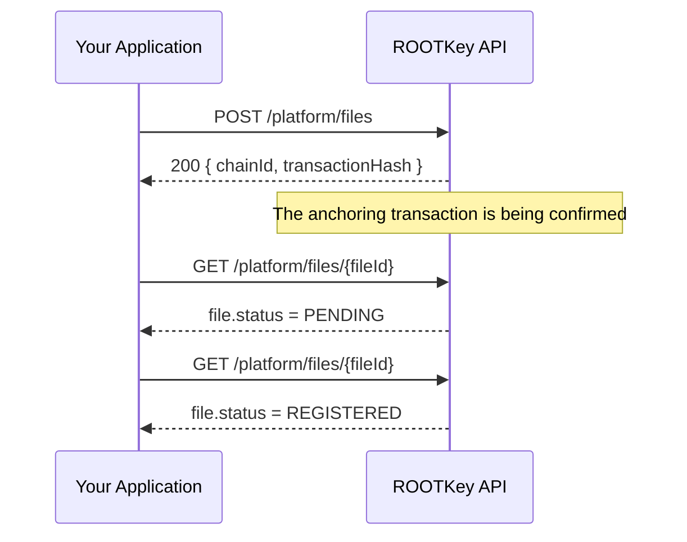

Anchoring a file on the blockchain does not finish inside the API call. The create request returns as soon as the anchoring transaction has been submitted, and the transaction is confirmed afterwards. The file's `status` tells you which side of that line it is on.

To find out when a file has been anchored, check its status until it settles.

---

## How It Works



1. You create the file - the response is immediate and carries the `transactionHash` of the anchoring transaction
2. The file starts as `PENDING` while that transaction is confirmed
3. You read the file again, until its status is `REGISTERED` or `FAILED`

---

## File Statuses

| Status | Meaning |
|--------|---------|
| `PENDING` | The anchoring transaction has been submitted and is not confirmed yet. This is the status right after the file is created. |
| `REGISTERED` | The transaction was confirmed. The file is anchored. |
| `FAILED` | The anchoring transaction did not complete. The file is not anchored. |

A file in `REGISTERED` or `FAILED` is no longer waiting on a confirmation, so there is nothing left to wait for. A `REGISTERED` file stays `REGISTERED`.

Confirmation depends on the blockchain network, so do not assume a fixed delay between `PENDING` and `REGISTERED`.

### Retrying the anchoring

A file that is `FAILED` - or that stays `PENDING` far longer than you expect - can be sent for anchoring again from the file's actions menu in the ROOTKey dashboard. This submits a new transaction: the file goes back to `PENDING` and its `transactionHash` changes.

<Note>
  Only files are anchored on the blockchain. A record is stored, hashed and audited, and is `REGISTERED` as soon as it is created, with no transaction hash - there is nothing to wait for.
</Note>

---

## Following a File

<Steps>
  <Step title="Create the file">
    Call [Create file](/api-reference/platform/endpoint/files/create-file). The response contains the `chainId` and the `transactionHash` of the anchoring transaction.

    ```json
    {
      "chainId": 137,
      "transactionHash": "0xabc123..."
    }
    ```
  </Step>
  <Step title="Find the file's ID">
    The create response does not include the file's ID. [List the files](/api-reference/platform/endpoint/files/get-files) of the vault - newest first by default - and take the `id` of the file you just created. Match on `name`, and confirm in the next step that the `transactionHash` is the one you were given. If the same name was uploaded more than once, the hash is what tells them apart.
  </Step>
  <Step title="Check the status">
    Call [Fetch file](/api-reference/platform/endpoint/files/get-file-by-id) with the `fileId` and the `ownerVault`. The status is in `file.status`, and `file.transactionHash` is the anchoring transaction.
  </Step>
  <Step title="Repeat until it settles">
    Keep checking while the status is `PENDING`. Stop at `REGISTERED` or `FAILED`.
  </Step>
</Steps>

### Checking many files at once

To follow several uploads without a request per file, list the vault's files with the `status` filter set to `pending`. Files that are no longer in that list have settled - read them to see whether each is `REGISTERED` or `FAILED`.

```bash
curl "https://api.rootkey.ai/api-v1/platform/files?vaultAddress=0xYourVault&status=pending" \
  -H "x-api-key: YOUR_API_KEY"
```

The `status` filter takes lowercase values - `pending`, `registered` and `error` - where `error` matches the files whose status is `FAILED`.

---

## Example

```python
import time
import requests

BASE_URL = "https://api.rootkey.ai/api-v1"
HEADERS = {"x-api-key": "YOUR_API_KEY"}


def wait_for_anchor(file_id: str, vault_address: str, give_up_after_s: int = 600) -> str:
    """Return REGISTERED or FAILED, once the file has settled."""
    delay = 2
    deadline = time.monotonic() + give_up_after_s

    while time.monotonic() < deadline:
        response = requests.get(
            f"{BASE_URL}/platform/files/{file_id}",
            params={"ownerVault": vault_address},
            headers=HEADERS,
            timeout=30,
        )

        if response.status_code == 429:
            time.sleep(int(response.headers.get("Retry-After", delay)))
            continue

        response.raise_for_status()
        status = response.json()["file"]["status"]

        if status in ("REGISTERED", "FAILED"):
            return status

        time.sleep(delay)
        delay = min(delay * 2, 30)

    raise TimeoutError(f"File {file_id} is still PENDING")
```

---

## Best Practices

**Do not hold the upload request open**
Store the file's ID and `transactionHash` when you create it, and check the status from a background job or a later request. Your user-facing request does not need to wait for the anchor.

**Back off between checks**
Start with a short delay and make it longer after each response that is still `PENDING`, as the example does. A tight loop adds load without making the anchor confirm sooner.

**Respect the rate limits**
Every check is an API request and counts against your plan. On a `429` response, wait for the number of seconds in the `Retry-After` header. See [Rate Limits](/pages/rate-limits).

**Treat `PENDING` as not yet proven**
Until the status is `REGISTERED`, do not present the file as anchored or rely on it as evidence.

**Handle `FAILED`**
A `FAILED` file has not been anchored, so do not rely on it. [Retry the anchoring](#retrying-the-anchoring) from the dashboard, and if it keeps failing contact [support@rootkey.ai](mailto:support@rootkey.ai) with the file ID.
