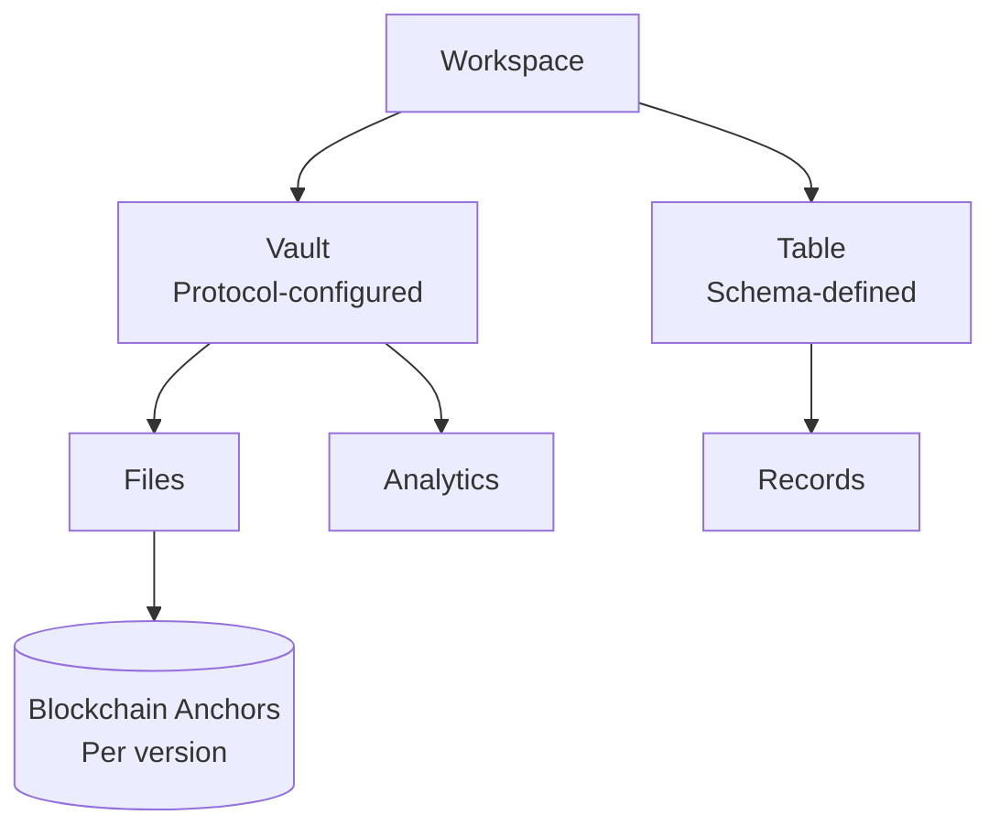

This page defines the key concepts, data model primitives, and terminology used throughout the ROOTKey platform and documentation. Understanding these concepts is the foundation for a correct integration.

---

## Data Model

Vaults and tables are separate containers, each with its own address: vaults hold files, tables hold records.

---

## Workspace

A **Workspace** is the top-level organisational unit in ROOTKey. It corresponds to your organisation or project. All API keys, vaults, tables, and usage metrics are scoped to a workspace.

A single account can manage multiple workspaces (e.g. one per environment, product line, or client).

---

## Vault

A **Vault** is the container that holds your files in ROOTKey. Every file belongs to a vault. Tables are not part of a vault: a [Table](#table) is a separate container for records, with its own address.

Vaults are configured with:
- A **data processing protocol** (RKP-1, RKP-2, or RKP-3) - determines how assets are anchored
- **Access controls** - which API keys can read or write
- **Lifecycle state** - active, deactivated, or deleted

The vault is the unit of protocol configuration. You cannot mix protocols within a single vault - design your vault architecture around your data classification requirements.

See: [Protocols](/pages/protocols/overview) · [Data Retention](/pages/retention-policies)

---

## File

A **File** is the primary asset type within a vault. In ROOTKey's model, a "file" is not limited to a literal document - it is a versioned, integrity-anchored data asset that can represent any content: a document, a record, a dataset export, a configuration, or any other payload.

Each file has:
- A unique identifier
- A creation timestamp and blockchain anchor
- A version history (every update creates a new version)
- A validation state (valid, invalid, or not yet validated)
- An owner (the wallet of the vault it belongs to)

---

## Version

A **Version** is an immutable snapshot of a file at a point in time. Every write to a file creates a new version - the previous version is never modified or deleted.

Each version has:
- Its own blockchain anchor
- Its own integrity hash
- A timestamp and sequence number
- A link to the previous version (lineage)

This allows any version of a file to be independently validated at any point in its lifecycle - including versions from years in the past.

---

## Validation

**Validation** is the process of verifying that a file has not been tampered with since it was anchored.

Validation works by:
1. Re-computing the SHA-256 hash of the current content
2. Comparing it against the hash stored in the on-chain anchor
3. Returning a **valid** or **invalid** result

A validation result is itself a blockchain operation - the result is anchored, creating an immutable audit record of when the validation was performed and by whom.

---

## Table

A **Table** is a structured, schema-defined data store for [records](#record). A table is not part of a vault: it is a container of its own, created and addressed separately. Tables allow you to store and manage datasets with defined column types, rather than arbitrary file payloads.

Vaults hold files and tables hold records, and the two are not interchangeable. An API call that names the wrong kind of container - a vault's address where a table's is expected, or the reverse - is answered with [`resource_not_found`](/api-reference/errors#resource_not_found).

Each write to a table (create or update record) is recorded individually, with its own entry in the table's activity history, providing row-level auditability for structured data.

---

## Record

A **Record** is an individual row within a table. Every record belongs to exactly one table, and the API identifies that table by its address. That address travels in fields named `ownerVault` (when you write a record) and `vaultAddress` (when you list records); despite the names, it is the **table's** address you pass there, not a vault's.

Like files, records are versioned - every update creates a new version. A record's full version history and activity history can be queried.

See: [Records API](/api-reference/platform/endpoint/records/overview)

---

## Protocol (RKP)

A **Protocol** defines how data is processed and anchored. ROOTKey uses a standardised naming convention - **RKP-N** - to identify each protocol:

| Protocol | Name | Summary |
|----------|------|---------|
| RKP-1 | Full On-Chain | Every operation written directly to the blockchain |
| RKP-2 | Off-Chain | High-throughput processing; off-chain integrity records, nothing written on-chain |
| RKP-3 | Hybrid | On-chain for critical events; off-chain for volume |

The protocol is configured at the vault level and applies to all assets within that vault.

See: [Protocols](/pages/protocols/overview)

---

## Blockchain Anchor

A **Blockchain Anchor** is the on-chain record produced by a write operation. It contains:

- **SHA-256 hash** of the data payload
- **Block timestamp** - the moment the anchor was written
- **Operation type** - create, update, validate
- **Asset identifiers** - the owning vault and the file
- **Originating wallet address**

Anchors are permanent and publicly queryable on Polygon. They are the cryptographic root of trust for every integrity guarantee ROOTKey provides.

---

## Wallet

A **Wallet** is a blockchain identity - a public/private key pair used to sign and own on-chain operations. Every vault and every table has a wallet of its own, created together with it, and the wallet's address is the vault's or table's address. A file anchored in a vault is owned, on-chain, by that vault's wallet.

ROOTKey generates and holds these keys on your behalf: the API never asks you for a private key and never returns one. Which key signs the blockchain transactions that anchor your files depends on who pays the network fees under your subscription. By default ROOTKey pays and signs with its own key; if the subscription is set up for you to pay the fees, the vault's own key signs instead.

In an on-premise installation the wallets that sign never leave your environment.

See: [On-premise](/pages/on-premise/overview)

---

## API Key

An **API Key** is the credential used to authenticate requests to the ROOTKey API. Each key is:

- Scoped to a workspace
- Bound to an environment (sandbox or production)
- Revocable at any time

Development keys are used with `https://dev-api.rootkey.ai`. Production keys are used with `https://api.rootkey.ai`. Switching environments requires updating both the base URL and the API key.

See: [API Keys](/pages/api-keys) · [Environments](/pages/environments)

---

## Credit

A **Credit** is the unit of consumption used by ROOTKey's billing model. Each operation consumes a defined number of credits depending on the operation type and the active protocol. Credits are purchased as part of a subscription plan.

See: [Pricing](/pages/pricing)

---

## Webhook

A **Webhook** is an HTTP callback that ROOTKey sends to a client-defined endpoint when an asynchronous event completes - such as blockchain anchoring in RKP-1 or RKP-3, or a validation result.

Webhooks allow integrations to react to ROOTKey events in real time without polling the API.

See: [Webhooks](/pages/webhooks)
