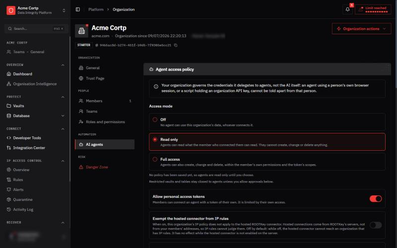
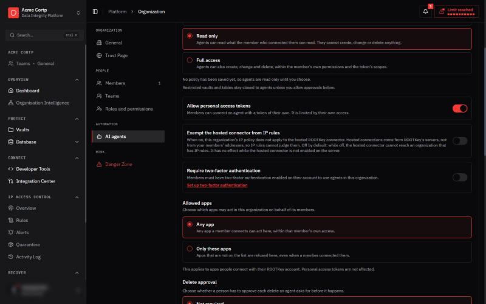
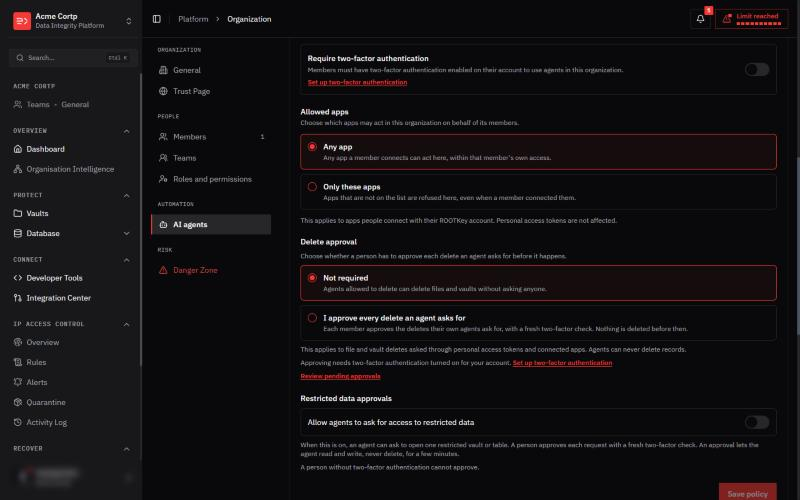
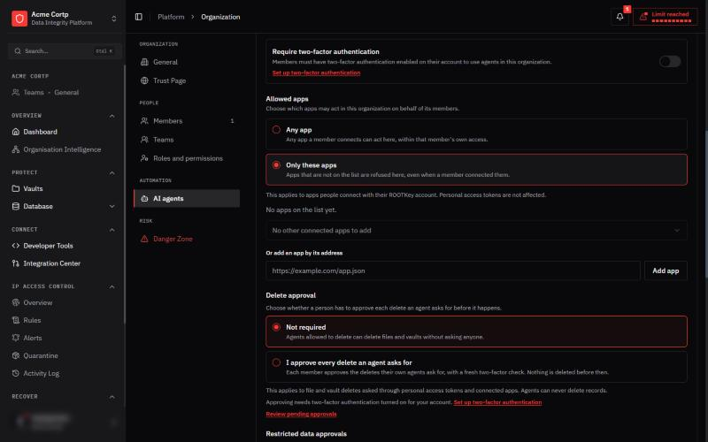
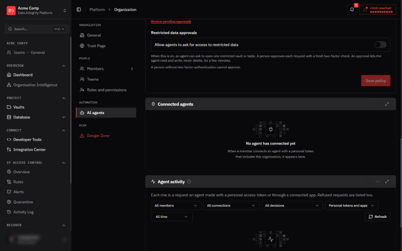

Members of your organization can connect an AI agent, such as Claude, to ROOTKey with a [personal access token](/api-reference/auth#personal-access-tokens), or by signing in to ROOTKey from an app through the [hosted connector](/pages/integrations/hosted-connector). Any app that supports MCP can connect that way, not only Claude. The agent then acts as that member, with no more access than the member has in the ROOTKey app. As an administrator, you decide whether agents may use your organization's data at all, and how far.

This page is for administrators. If you are a member who wants to connect an agent, start with [Claude (MCP)](/pages/integrations/claude-mcp). Developers who build an agent will find what it sends to create a table in [Create a table or a vault for a team](#create-a-table-or-a-vault-for-a-team).

---

## Where to find it

Open **Organization Settings** and go to the **AI agents** tab. It has two parts: the **Agent access policy**, where you choose what agents may do, and **Connected agents**, which lists the members who have connected one.



The tab is for members whose role has the **AI agents** permissions: **read** lets a member see the policy and the connections, and **update** lets them change the policy and block members. Owners and administrators have both by default, and you can give them to a custom role under **Roles and permissions**. If you do not see the tab, your role does not have the permission, or agent access is not available on your deployment.

---

## Choose what agents may do

The **Access mode** decides what an agent can do in your organization, whoever connects it:

| Mode | What agents can do |
|---|---|
| **Off** | Nothing. No agent can use the organization's data. Every request from an agent is refused. |
| **Read only** | Read what the member who connected the agent can read. Agents cannot create, change or delete anything. |
| **Full access** | Read, and also create, change and delete, within the member's own permissions and the scopes of the member's token. Deletes can need the member's approval: see [Approve every delete an agent asks for](#approve-every-delete-an-agent-asks-for). |

**Read only** is the mode of every organization until an administrator saves another one. Nothing is switched on for you: an organization that has never opened this tab lets agents read and nothing more.

Even in **Full access**, an agent is bounded three times over. It can do only what the member's role and teams allow, only what the scopes of the member's token allow, and only what is not on the [always blocked](#what-is-always-blocked) list below. The API reports the mode of each organization as `DISABLED`, `READ_ONLY` or `FULL`.

<Tip>
  Start in **Read only**, let members try agents on data they can already read, and move to **Full access** when you are ready for agents to create, change and delete. Members can use test data while they try things out: see [Test and Live Data](/pages/environments).
</Tip>

### Allow personal access tokens

**Allow personal access tokens** is on by default. When you turn it off, no personal access token works in your organization from that moment, including every token that was already connected and every token created later. Members' tokens are not deleted: if you turn the setting back on, the tokens that have not expired or been revoked work again.

### Require two-factor authentication

When you turn on **Require two-factor authentication**, only members who have turned on two-factor authentication on their own ROOTKey account can use agents in your organization. A member who has not loses their agents' access at once, and the refusal says why ([`agent_two_factor_required`](/api-reference/errors#agent_two_factor_required)). Their own access in the ROOTKey app does not change.

Members can turn on two-factor authentication themselves under **Account Settings → Security**, with an authenticator app and backup codes. Ask your members to do this before you turn the requirement on, or they will lose their agents until they have.



### Approve every delete an agent asks for

**Delete approval** decides whether a person must approve an agent's delete of a file or a vault. It has two values:

- **Not required** is the setting until you choose another. An agent's delete runs as soon as it asks, within the member's permissions and the token's scopes.
- **I approve every delete an agent asks for** refuses the delete first ([`agent_approval_required`](/api-reference/errors#agent_approval_required)) and deletes nothing. The member whose agent asked approves it in the ROOTKey app under **Pending approvals**, with a fresh two-factor check, and the agent then repeats the same request, which runs once. A member who has not turned on two-factor authentication cannot approve.

A request waits 24 hours. Restores never need an approval, and agents never delete records. See [Delete approvals](/pages/integrations/delete-approvals).



### Let members open Restricted data to their own agents

By default no agent reaches **Restricted** vaults and tables. This option, which is off until you turn it on, lets a member open one Restricted vault or table to their own agent for a few minutes: the agent asks, and the member approves with a fresh two-factor check. It covers reading and writing only. See [Restricted data and agents](/pages/integrations/restricted-step-up).

### Choose which apps may act

**Allowed apps** decides which apps a member can connect to your organization through the [hosted connector](/pages/integrations/hosted-connector):

- **Any app** is the setting until you choose another. Any app a member connects may act in the organization, within that member's own access.
- **Only these apps** lets only the apps on your list act in the organization. Build the list from the apps your members have already connected, or add an app by the `https://` address of its client metadata. A list holds up to 50 apps.

With a list on, your organization shows as unavailable on the consent screen for an app that is not on it, and a request from an app that is already connected but not on the list is refused with [`agent_client_not_allowed`](/api-reference/errors#agent_client_not_allowed). That app's connection is not removed: it works again as soon as you add it back. The organization's agent activity shows the refusals as requests from an app that is not on the list.



<Warning>
  The list applies to apps that people connect with their ROOTKey account. Personal access tokens are not affected by it, and neither are organization API keys: the other settings on this page govern tokens.
</Warning>

On the consent screen, an app may carry an **Unverified app** badge. It means ROOTKey has not confirmed who publishes the app, because the name and logo are declared by the app itself. It is not a review of the app, and it does not mean the app is safe or unsafe. See [What "Unverified app" means](/pages/integrations/hosted-connector#what-unverified-app-means). An allowed-apps list is how you decide which apps act in your organization, whatever their badge.

### When a change takes effect

A change you save applies to the next request an agent makes. Nothing waits for a token to expire or for a member to reconnect. ROOTKey asks you to confirm the changes that cut access: turning agents **Off**, switching to **Full access**, turning off personal access tokens, requiring two-factor authentication, restricting the allowed apps and allowing any app.

---

## Block or unblock a member

If you need to cut one member's agents without touching anyone else's, block that member. In **Connected agents**, open the actions menu of the member's row and choose **Block this member's agents**.

- Every token that member connected stops working **in this organization** at once. Their agents in other organizations are not affected.
- The member's own access in the ROOTKey app does not change.
- The member's agents are refused with [`agent_user_blocked`](/api-reference/errors#agent_user_blocked), and the member sees `blocked: true` for your organization when an agent lists their organizations.
- You can unblock the member at any time with **Unblock this member's agents**. Their tokens that have not expired or been revoked work again.

An administrator cannot revoke a single token that belongs to a member. Members revoke their own under **Account Settings → Personal access tokens**, and blocking the member is the tool you have to cut them off.

---

## Create a table or a vault for a team

An agent can create a **vault**, which holds files, and a **table**, which holds records. Each one belongs to a team, and the customer is the one who knows which. This section is for developers who build an agent, and for administrators who want to know what an agent is allowed to do here.

These calls are for agents only. A personal access token or a connected app can make them. An organization API key is refused with `403` `access_denied` and nothing is created, which is why they are described on this page and not in the API reference.

### What it takes

- A token with the `rootkey.write` scope to create, and `rootkey.read` to list teams.
- The `X-RootKey-Organization` header on every call, naming the organization. Without it the call is a `400` [`organization_header_required`](/api-reference/errors#organization_header_required).
- An organization in **Full access** to create. **Read only** still lets an agent list teams. An organization that has agents off, or has blocked the member, refuses both: see [What your members see](#what-your-members-see).
- A role that allows the member to create tables, and to read teams. A member whose role does not gets [`insufficient_permission`](/api-reference/errors#insufficient_permission).
- A member can create for a team they belong to. An owner or an administrator can create for any team of the organization.

An agent creates at most 20 tables and vaults together per minute and member. Every request counts, whether it succeeds or not, and the count starts again at the beginning of each minute. Over the limit, the request gets `429` with a `Retry-After` header that gives the seconds to wait. Organization API keys are never limited this way.

### List the teams

An agent calls `GET https://api.rootkey.ai/api-v1/teams` to find the teams it can offer, then asks the customer which one should own the vault or the table. The team id is not something the customer knows.

For an owner or an administrator the list is every team of the organization. For any other member it is the teams the member belongs to. A member who belongs to no team gets an empty list, not an error. It never lists a team of another organization, and it never lists members, vaults or tables.

```json
{
  "data": [
    { "id": "3f8e2c1a-0b6d-4a57-9c1e-5d2f7a8b9c10", "name": "General" },
    { "id": "kT3mQ9xV2bN7rLw4yHc8dJzP5sGa6FeU", "name": "Finance", "description": "Accounts and audit" }
  ],
  "pagination": { "previousCursor": null, "nextCursor": null },
  "metadata": {
    "fetchedCount": 2,
    "totalCount": 2,
    "serverTimestamp": "2026-11-15T10:00:00.000Z",
    "parameters": { "limit": 20, "cursor": null, "order": "desc" }
  }
}
```

- A team has an `id`, a `name` and, only when it has one, a `description`. The key is left out otherwise, never `null`.
- Do not assume what an `id` looks like. The team every organization starts with has a UUID, and a team made in the ROOTKey app has a 32-character alphanumeric id. Pass the id back exactly as listed.
- `limit` is a whole number from 1 to 500 (default 20) and `order` is `asc` or `desc` (default `desc`, newest team first). `cursor` is the `pagination.nextCursor` of the previous page, sent back unchanged. A `limit` or `order` that is not valid gets [`invalid_query_parameters`](/api-reference/errors#invalid_query_parameters). A cursor that is not valid gets [`invalid_cursor`](/api-reference/errors#invalid_cursor). Neither is replaced by a default.
- `metadata.totalCount` is the number of teams this member may list. The test or live data of the request makes no difference: teams are the same in both.
- An organization API key gets `403` `access_denied`.

### Create a table

An agent calls `POST https://api.rootkey.ai/api-v1/tables` (also `POST /api-v1/platform/tables`) and sends the table already defined, schema included. There is no default team and no default schema: a request without `teamId` or without a valid `schema` is a `400`. An agent must ask the customer for these before it calls, and never guess them:

- the team that owns the table,
- the table's name, and a description if the customer wants one,
- every column: its name, its type (`string`, `number`, `boolean`, `date` or `json`) and whether a value is required,
- which column is the **primary key**. Writing a record whose primary key matches an existing one adds a version of that record instead of a second record.

```json
{
  "tableName": "Customers",
  "description": "One record per customer",
  "teamId": "kT3mQ9xV2bN7rLw4yHc8dJzP5sGa6FeU",
  "schema": {
    "columns": [
      { "name": "customer_id", "type": "string", "required": true, "primaryKey": true },
      { "name": "email", "type": "string", "required": true, "limit": 320 },
      { "name": "active", "type": "boolean", "required": false }
    ]
  }
}
```

| Field | Rule |
|---|---|
| `tableName` | Required. 1 to 255 characters after the spaces at both ends are removed, with no control characters. |
| `description` | Optional. Up to 1000 characters. It can run over several lines. |
| `teamId` | Required. An id from the teams list, 1 to 64 characters. |
| `schema.columns` | Required. 1 to 200 columns. |
| `name` | Letters, digits and underscores, starting with a letter or an underscore, up to 255 characters. Names are unique, upper and lower case counting as the same. |
| `type` | `string`, `number`, `boolean`, `date` or `json`. |
| `required` | `true` or `false`. At least one column must be required. |
| `limit` | Optional. A whole number from 1 to 100000: the longest entry the column holds. |
| `primaryKey` | Exactly one column sets it to `true`, and that column must be required. |

A key that is not in this list, in the body's `schema` or in a column, is refused, so a misspelled `primary_key` is never dropped without a word. The schema is stored as its first version.

A table that is created answers `201` with its address:

```json
{
  "chainId": 137,
  "address": "0x4b1d0f9a2c7e83d5a6b1c0e9f2d3a4b5c6d7e8f9",
  "name": "Customers",
  "description": "One record per customer"
}
```

Keep the `address`: it is what an agent passes to write and list the table's records. The response never includes the schema.

| Status | `errorCode` | What happened |
|---|---|---|
| `400` | `invalid_fields` | `tableName`, `description` or `teamId` is missing, too long or malformed. The answer names the fields and does not repeat what was sent. |
| `400` | `invalid_table_schema` | The schema is missing, or breaks one of the rules above. |
| `400` | [`usage_limit_exceeded`](/api-reference/errors#usage_limit_exceeded) | The plan's limit on tables, or on API requests, is reached. Nothing is created. |
| `403` | `access_denied` | The caller is not an agent: an organization API key, for one. |
| `403` | `not_a_team_member` | The member is not in the team, and is not an owner or an administrator. Ask the customer to choose another team, or ask a team member. |
| `403` | [`insufficient_permission`](/api-reference/errors#insufficient_permission), [`agent_write_not_allowed`](/api-reference/errors#agent_write_not_allowed) and the other [agent refusals](/api-reference/errors#personal-access-tokens-and-agents) | The member's role, the token or the organization does not allow it. Tell the customer and stop. |
| `404` | [`resource_not_found`](/api-reference/errors#resource_not_found) | The team does not exist in the organization. A team of another organization is answered the same way. |
| `429` | | More than 20 tables and vaults created in the minute, or the general [rate limit](/pages/rate-limits). Wait the seconds in `Retry-After`. |

A table counts against the plan's limit on tables. A plan with no limit on tables is not capped.

### Create a vault for a team

An agent creates a vault with `POST /platform/vaults`, as the [API reference](/api-reference/platform/endpoint/vaults/create-vault) describes. Its `teamId` is optional, and it takes any team id of the organization, in the same form the teams list gives it, not only a UUID.

- With a `teamId`, the vault belongs to that team. An id that names no team of the organization is a `404` `resource_not_found`.
- Without a `teamId`, the vault belongs to the team named **General**. If the organization has no team with that name, the answer is a `404` `resource_not_found` whose message reads `Team named "General" not found`. An agent that gets it should list the teams and ask the customer.
- An owner or an administrator can create for any team of the organization only when they send a `teamId`. Without one, the member has to belong to **General**, or the answer is a `403` `not_a_team_member`.

<Warning>
  The agent creates the vault or the table for the team the customer chose. If it picks a team for them, the customer may not find what the agent made. Only the members of that team, and the owners and administrators, can see it.
</Warning>

---

## What is always blocked

Whatever mode you choose, and whatever scopes a token carries, an agent that uses a personal access token never gets:

- **Restricted vaults and tables, unless you allow approvals.** They are listed to the agent with `agentAccessible: false`, so it can tell the member they exist. With the option to open Restricted data to members' agents off, every request that would read or change them is refused ([`agent_restricted_data_denied`](/api-reference/errors#agent_restricted_data_denied)). With it on, a read or a write needs the member's approval first, and **deleting or restoring Restricted data stays refused, even with an approval**.
- **Deleting a record.** Agents never delete records. They can restore them.
- **Fetching, downloading, creating or deleting a recovery point.** An agent can only list them, and only the ones whose every vault the member can read now. A recovery point that covers a Restricted vault, a deleted vault or a vault an IP rule hides is never listed, administrators included.
- **Changing a vault's data classification.** How a vault's data is treated stays with a person.

These are refused with [`agent_route_not_available`](/api-reference/errors#agent_route_not_available), [`agent_restricted_data_denied`](/api-reference/errors#agent_restricted_data_denied) or [`agent_classification_change_not_allowed`](/api-reference/errors#agent_classification_change_not_allowed). The agent is told to stop and send the member to the ROOTKey app.

Agents can list what is in the trash and restore it, and can queue a file audit report, within the member's permissions and the scopes of the token. See [Trash and restore for agents](/pages/integrations/agent-trash-and-restore).

The rules you already set still apply. Your organization's IP and country access rules judge the requests of a personal access token like any other request, and an agent sees only what its member sees in the ROOTKey app: for vaults, those of the member's teams, unless the member is an owner or an administrator.

<Note>
  Your organization governs the credentials it delegates to agents, not the AI itself: an agent using a person's own browser session, or a script holding an organization API key, cannot be told apart from that person.
</Note>

This is the honest limit of the policy. It controls the tokens members create for their agents. It cannot tell whether a person or an AI is using a member's signed-in browser, and it does not govern organization API keys, which belong to your organization and act with the full privileges of the account that created them. Manage those in **Developer Tools**, see [API Keys](/pages/api-keys).

---

## See who has connected an agent

**Connected agents** lists every active token and every connected app that can reach your organization (a connected app has the type **Connected app**), with:

| Column | What it shows |
|---|---|
| **Member** | The member who connected the agent. |
| **Token** | The name the member gave the token, and its type. |
| **Permissions** | The scopes of the token: read, write and delete. |
| **Last used** | When the token last made a request. It updates every few minutes, so a token used a moment ago can still show **Never**. |
| **Expires** | When the token stops working. A token lasts at most 90 days. |
| **Status** | **Active**, or **Blocked** when you have blocked the member. |

Until a member connects an agent that includes your organization, the list is empty.



Each member sees and revokes their own tokens under **Account Settings → Personal access tokens**.

---

## What your members see

When an agent is refused by your policy, the error names the cause and what has to change. Members are told to ask an organization administrator, and agents are told to stop instead of retrying or trying another organization. The codes are on the [Errors](/api-reference/errors#personal-access-tokens-and-agents) page.

| What you set | What a member's agent gets |
|---|---|
| Mode **Off** | [`agent_access_disabled`](/api-reference/errors#agent_access_disabled) on every request |
| Mode **Read only** | [`agent_write_not_allowed`](/api-reference/errors#agent_write_not_allowed) on every create, change or delete |
| **Allow personal access tokens** off | [`agent_personal_tokens_disabled`](/api-reference/errors#agent_personal_tokens_disabled) on every request |
| **Require two-factor authentication** on | [`agent_two_factor_required`](/api-reference/errors#agent_two_factor_required) until the member turns it on |
| A member blocked | [`agent_user_blocked`](/api-reference/errors#agent_user_blocked) on every request |
| **Only these apps** on, and the app is not on the list | [`agent_client_not_allowed`](/api-reference/errors#agent_client_not_allowed) on every request from that app |
| **Delete approval** on | [`agent_approval_required`](/api-reference/errors#agent_approval_required) on a delete of a file or a vault, until the member approves |
| Restricted data opened to members' agents: off | [`agent_restricted_data_denied`](/api-reference/errors#agent_restricted_data_denied) on every request to Restricted data |
| Restricted data opened to members' agents: on | [`agent_step_up_required`](/api-reference/errors#agent_step_up_required) on a read or a write of Restricted data, until the member approves |

<CardGroup cols={2}>
  <Card title="Claude (MCP)" icon="robot" href="/pages/integrations/claude-mcp">
    How a member connects Claude to ROOTKey, and what it can do.
  </Card>
  <Card title="Hosted connector" icon="plug" href="/pages/integrations/hosted-connector">
    How any MCP client connects by signing in, and what the consent screen shows.
  </Card>
  <Card title="Delete approvals" icon="user-check" href="/pages/integrations/delete-approvals">
    Approve every delete an agent asks for.
  </Card>
  <Card title="Restricted data and agents" icon="lock" href="/pages/integrations/restricted-step-up">
    Open one Restricted vault or table to a member's agent for a few minutes.
  </Card>
  <Card title="Personal access tokens" icon="key" href="/api-reference/auth#personal-access-tokens">
    How tokens, scopes and organizations fit together.
  </Card>
</CardGroup>
